# Awesome Interactive Contract AI Engagement Agent 🤖⚖️

 

 

**Curated List of SaaS Products & Open-Source GitHub Projects for Contract Lifecycle Management (CLM), AI Legal Assistants, Autonomous Redlining, Clause Extraction & Natural-Language Contract Q&A**

*Last updated: November 2026* ⚡

---

## 📌 Table of Contents

- [🌟 Sector Overview & Market Dynamics](#-sector-overview--market-dynamics)
- [🏢 SaaS / Hosted Platforms](#-saas--hosted-platforms)
- [💻 Open-Source GitHub Projects](#-open-source-github-projects)
- [🛠️ Additional Open-Source Ecosystem Options](#️-additional-open-source-ecosystem-options)
- [🤝 How to Contribute](#-how-to-contribute)
- [💖 Support](#-support)
- [📈 Star History](#-star-history)
- [⚖️ Disclaimer](#️-disclaimer)

---

## 🌟 Sector Overview & Market Dynamics

The global Contract Lifecycle Management (CLM) and Legal AI Agent market is valued between **$2.5B and $3.4B in 2024–2026** and is projected to expand past **$5B+ by 2030 at an estimated CAGR of 12–13%**, fueled by generative AI adoption, autonomous redlining copilots, and multi-document compliance extraction. 

The industry exhibits a **moderately fragmented yet rapidly consolidating ecosystem** where horizontal mega-vendors (Thomson Reuters, Workday, DocuSign, SAP, Salesforce) aggressively acquire specialized category leaders, while high-valuation AI-native startups (Harvey AI, Ironclad, Icertis, Spellbook) coexist with self-hosted, air-gapped open-source legal RAG stacks built for strict attorney-client privilege.

---

## 🏢 SaaS / Hosted Platforms

Below is a curated comparison of category-leading SaaS contract AI engagement platforms, sorted in descending order by enterprise valuation and scale.

| Platform | Company Scale / Valuation | Description | Pricing (Starting Tier) | Free Tier / Trial Limits |
| :--- | :--- | :--- | :--- | :--- |
| **[Casetext CoCounsel (Thomson Reuters)](https://casetext.com)** | **$47B–$50B Market Cap** *(Parent TRI; acquired for $650M cash)* | AI legal assistant engineered for contract review, policy compliance checks, clause extraction, and document summarization. | Starts at $340–$350/user/month (CoCounsel Essentials, annual commitment) | **24-hour (1-day) free trial** for CoCounsel Legal with full platform access (no credit card required) |
| **[Harvey AI](https://harvey.ai)** | **$15.5B Valuation** *(Raised $550M+ Series E)* | Domain-specific generative AI platform built for law firms and enterprise legal teams to assist with contract analysis, due diligence, and legal drafting. | Custom enterprise quotes only; minimum starting entry is ~$1,200/user/month (with a standard 20–25 seat minimum, ~$288,000+/year) | No public free tier; structured enterprise pilots offered case-by-case (typically 30–90 days for qualified enterprise accounts) |
| **[Icertis Vera Engage](https://icertis.com)** | **$2.8B–$5.0B Valuation** *(~$350M+ ARR)* | Conversational generative AI contract engagement agent enabling business users to query agreements, summarize obligations, and surface risks in natural language. | Custom enterprise pricing; baseline deployments start at ~$48,000–$50,000/year for mid-market, scaling to $300,000+/year for enterprise | No self-serve free tier; custom proof-of-concept (PoC) / guided pilots arranged for qualified enterprise accounts (typically 30–60 days) |
| **[Ironclad AI Assist](https://ironcladapp.com)** | **$3.2B Valuation** *(~$200M+ ARR)* | AI-powered contract lifecycle management (CLM) assistant offering automated redlining, playbook-driven clause negotiation, and metadata extraction. | Entry mid-market packages start at ~$500/month or ~$15,000/year (billed annually based on user seats and contract volume) | **14-day sandbox trial** available upon request/sales qualification via free trial agreement |
| **[ContractPodAi Leah](https://contractpodai.com)** | **~$500M–$700M Valuation** *(Raised $170M+ total)* | Agentic legal AI platform providing interactive contract redlining, risk scoring, plain-English summaries, and intake triage. | Custom enterprise quotes; baseline deployment packages start at ~$50,000/year | No self-serve free tier; paid proof-of-concept (PoC) / custom pilots offered for enterprise evaluations |
| **[Luminance Chat](https://luminance.com)** | **~$450M–$500M Valuation** *(Raised $165M+ total)* | Specialized legal LLM and conversational assistant designed for autonomous contract negotiation, anomaly detection, and repository Q&A. | Custom quote based on contract repository volume and modules; average starting deployments in the five-figure range (~$30,000–$50,000+/year) | **14-day (2-week) guided trial/pilot** available upon request through sales with team supervision |
| **[Spellbook](https://spellbook.legal)** | **$350M Valuation** *(Raised $120M+ total, Series B)* | Generative AI contract drafting and review assistant operating inside Microsoft Word to suggest clauses, spot missing terms, and negotiate language. | Custom sales quote (industry benchmark starts at ~$100–$149/user/month billed annually) | **7-day free trial** with full Word add-in features and document review capabilities |
| **[Evisort Chat (Workday)](https://evisort.com)** | **$311M Valuation** *(Acquired by Workday for $311M cash)* | Contract intelligence platform featuring a conversational AI assistant for searching, redlining, and extracting structured terms across legacy agreements. | Custom annual subscription; mid-market entry tiers start at ~$15,000–$30,000/year (or packaged within Workday CLM) | No self-serve free tier; custom guided proof-of-concept (PoC) / pilot available via enterprise sales inquiry |
| **[Lexion AI (DocuSign)](https://lexion.ai)** | **$165M Valuation** *(Acquired by DocuSign for $165M cash)* | AI-driven contract management and conversational assistant automating intake workflows, clause summaries, and obligation alerts. | Custom annual quotes; entry deployments start at ~$15,000/year based on contract volume and core user seats | No self-service free tier; guided pilot / proof-of-concept (PoC) evaluations negotiable via DocuSign sales |
| **[Robin AI Assistant](https://robinai.com)** | **~$70M–$100M Valuation** *(Raised $71.7M total)* | Interactive legal copilot embedded directly in Microsoft Word for drafting, reviewing, and redlining contracts against corporate playbooks. | Free tier available; Pro plan starts via sales-quoted / custom tiers (estimated ~$40–$80/user/month for up to 5 seats; custom enterprise) | **Free forever plan**: 1 user, strictly limited to 10 AI messages/day with basic document assistance |

---

## 💻 Open-Source GitHub Projects

Explore production-grade open-source tools for building self-hosted, confidential contract intelligence engines, private legal RAG pipelines, automated redlining agents, and clause extractors. Sorted in descending order by GitHub stargazers count.

1. **[Dify](https://github.com/langgenius/dify)**   
   Open-source LLM application development platform and agent orchestrator ideal for building custom multi-step legal contract review agents, clause extractors, and automated corporate playbook checkers.

2. **[Docling](https://github.com/docling-project/docling)**   
   Production-ready open-source document parsing toolkit capable of converting complex multi-column legal PDFs, scans, and signed contracts into structured Markdown and JSON with visual grounding.

3. **[AutoGen](https://github.com/microsoft/autogen)**   
   Multi-agent conversation framework enabling teams of specialized AI agents (such as Drafter, Risk Reviewer, Compliance Officer, and Negotiator) to collaborate autonomously on complex contract workflows.

4. **[PrivateGPT](https://github.com/zylon-ai/private-gpt)**   
   Production-ready open-source RAG API allowing legal departments to query sensitive and confidential contracts completely offline on air-gapped infrastructure with 100% data privacy.

5. **[Flowise](https://github.com/FlowiseAI/Flowise)**   
   Open-source visual drag-and-drop builder for orchestrating agentic legal RAG workflows, contract comparison pipelines, and conversational legal Q&A bots.

6. **[Paperless-ngx](https://github.com/paperless-ngx/paperless-ngx)**   
   Self-hosted open-source document management system featuring OCR, tagging, email ingestion, and full-text search that integrates cleanly with local legal AI agents for contract archiving.

7. **[LibreChat](https://github.com/LibreChat-AI/LibreChat)**   
   Enhanced open-source ChatGPT-style web UI featuring multi-model routing, Model Context Protocol (MCP), custom legal system prompts, artifacts, and multi-file RAG chat over agreements.

8. **[Marker](https://github.com/datalab-to/marker)**   
   High-accuracy, high-speed open-source pipeline for converting complex legal PDFs, court filings, and contracts into clean Markdown and structured JSON for LLM consumption.

9. **[LightRAG](https://github.com/HKUDS/LightRAG)**   
   Fast and lightweight open-source Retrieval-Augmented Generation engine combining graph-based structures with dual-level retrieval for mapping cross-contract relationships and amendments.

10. **[Google LangExtract](https://github.com/google/langextract)**   
    Open-source Python framework from Google for extracting structured information, contract dates, counterparties, and contractual commitments from unstructured text with verifiable source grounding.

11. **[Khoj](https://github.com/khoj-ai/khoj)**   
    Self-hostable personal AI assistant and offline search engine capable of indexing local legal contract repositories, PDFs, and Word documents for conversational Q&A.

12. **[Microsoft GraphRAG](https://github.com/microsoft/graphrag)**   
    Modular, graph-based RAG system built to extract knowledge graphs from legal document collections, enabling holistic queries across entire corporate agreement repositories.

13. **[Onyx (formerly Danswer)](https://github.com/onyx-dot-app/onyx)**   
    Open-source enterprise AI assistant and semantic search engine connecting directly to Google Drive, SharePoint, OneDrive, and Slack for cited contract Q&A.

14. **[Kotaemon](https://github.com/Cinnamon/kotaemon)**   
    Clean, customizable open-source RAG interface engineered specifically for conversational document Q&A over complex legal agreements with inline citations and document preview panels.

15. **[Surya](https://github.com/datalab-to/surya)**   
    Multilingual document OCR, layout analysis, table recognition, and reading order detection model for scanning physical agreements and legacy contract scans.

16. **[DocuSeal](https://github.com/docusealco/docuseal)**   
    Open-source, self-hosted DocuSign alternative for creating, filling, sending, and digitally signing contracts with automated webhook integrations for AI pipelines.

17. **[Unstructured](https://github.com/Unstructured-IO/unstructured)**   
    Open-source data ingestion and ETL preprocessing library specifically built for chunking, parsing, and normalizing PDF, DOCX, and scanned contracts for legal AI models.

18. **[OpenContracts](https://github.com/Open-Source-Legal/OpenContracts)**   
    Open-source enterprise document and contract analytics platform offering visual annotation, citation graphs, vector search, and Model Context Protocol (MCP) integrations.

19. **[Docassemble](https://github.com/jhpyle/docassemble)**   
    Free, open-source expert system and guided interview engine for automated legal document assembly, customized contract generation, and legal ops workflows.

20. **[Blackstone](https://github.com/ICLRandD/Blackstone)**   
    Open-source spaCy NLP pipeline and model specifically trained for parsing legal texts, statutory instruments, and contractual entities.

21. **[CUAD (Contract Understanding Atticus Dataset)](https://github.com/The-Atticus-Project/cuad)**   
    Open-source legal dataset and baseline NLP models curated by legal experts for identifying 41 critical commercial contract clauses and risk triggers.

22. **[Accord Project Template Archive (Cicero)](https://github.com/accordproject/template-archive)**   
    Open-source smart legal contract framework and template engine enabling natural-language agreements to be parsed, validated, and executed with data schemas.

23. **[LexGLUE](https://github.com/coastalcph/lex-glue)**   
    Comprehensive open-source legal NLP benchmark across seven tasks including contract clause classification, legal QA, and judicial outcome prediction.

24. **[Accord Project Concerto](https://github.com/accordproject/concerto)**   
    Domain-specific modeling language and schema runtime for machine-readable legal contracts, clause validation, and structured contract execution.

---

## 🛠️ Additional Open-Source Ecosystem Options

- **Local LLM Execution**: Run air-gapped legal models locally via [Ollama](https://github.com/ollama/ollama), [vLLM](https://github.com/vllm-project/vllm), and [llama.cpp](https://github.com/ggerganov/llama.cpp) with zero cloud exposure.
- **Agent Orchestration**: Build custom contract review graphs with [LangGraph](https://github.com/langchain-ai/langgraph) or [LlamaIndex Workflows](https://github.com/run-llama/llama_index).
- **Template Libraries**: Leverage standardized NDA, MSA, SLA, and SaaS agreement templates through the [Accord Project](https://github.com/accordproject).
- **Architecture Blueprints**: Combine **Docling** / **Marker** (parser) with **OpenContracts** / **Kotaemon** (UI & citations), **Google LangExtract** (metadata extraction), and **vLLM** + **LangGraph** for enterprise-grade, private contract AI agents.

---

## 🤝 How to Contribute

Contributions are warmly welcomed! Help keep this ecosystem up-to-date and comprehensive:

1. **Fork the repository** 🍴
2. **Create a branch** for your feature or addition (`git checkout -b add-contract-agent`)
3. **Add your entry** to `README.md` keeping alphabetical or star-based sorting, factual descriptions, and working links.
4. **Commit your changes** (`git commit -m 'Add awesome legal AI agent'`)
5. **Push to the branch** (`git push origin add-contract-agent`)
6. **Open a Pull Request** 🚀 with a brief explanation of the tool.

---

## 💖 Support

If you find this repository helpful for your legal engineering, legal ops, or contract AI research, please consider supporting the project! ⭐

- **Star this repository** to help others discover it.
- **Fork and contribute** updates, new tools, and benchmarks.
- **Share** this list with colleagues, legal teams, and developers.
- **Buy a Coffee / Sponsor**: Support continued open-source legal-tech curation via the [GitHub Sponsor Dashboard](https://github.com/sponsors/ishandutta2007) ☕

---

## 📈 Star History

---

## ⚖️ Disclaimer

- This is a **community-curated** list for informational and educational purposes only.
- Contract AI engagement agents assist with legal operations, triage, and drafting review, but **do not constitute legal advice**; all work outputs should be reviewed and verified by qualified legal counsel.
- Self-hosted open-source contract AI deployments handling privileged documents must ensure robust client confidentiality, attorney-client privilege protections, encryption at rest and in transit, and strict zero-data-retention parameters.

---

**Made with ❤️ for legal ops teams, corporate counsel, contract managers, and legal-tech engineers.**  
*Making contract drafting, negotiation, and engagement more intelligent, transparent, and private.*

